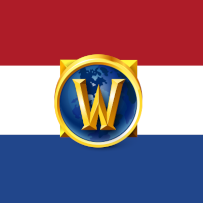

# Speurtocht.NL — Dutch quest text for World of Warcraft

*Nederlandse versie: zie [LEESMIJ.md](LEESMIJ.md)*

Speurtocht.NL shows quest text in Dutch and leaves the rest of the game in English. It's built for learning Dutch while you play:

- **Graded Dutch** that starts at A1–A2 and grows to B1–B2 as your character levels up.
- **The English original** whenever you need it: hold Alt, or hover the NLQuest button.
- **A side-by-side reader** with Dutch next to English, where every Dutch word can be clicked.
- **A vocabulary list** of the words you click, ready to import into Anki.
- **Every Classic Era quest**, Alliance and Horde: more than 4,200 in all.

**Version 0.3.0** · Classic Era (1.15) now · World of Warcraft: Forever (1.60) from launch

---

## 1. Install

**With an addon manager:** search for **Speurtocht.NL** in the CurseForge app or WowUp and click Install. Updates then arrive by themselves.

**By hand:**

1. Download **[SpeurtochtNL.zip](https://github.com/emergencepathways/NLQuest/releases/latest/download/SpeurtochtNL.zip)** (always the newest version) and unzip it. You get a folder called `SpeurtochtNL`.
   Don't use the green **Code › Download ZIP** button on GitHub: that gives a folder called `NLQuest-main`, which the game won't load.
2. Copy that folder into the game's AddOns folder:
   - **Windows:** `C:\Program Files (x86)\World of Warcraft\_classic_era_\Interface\AddOns\`
   - **macOS:** `/Applications/World of Warcraft/_classic_era_/Interface/AddOns/`
   - **Linux (Steam/Proton):**
     ```
     ~/.local/share/Steam/steamapps/compatdata/<number>/pfx/drive_c/Program Files (x86)/World of Warcraft/_classic_era_/Interface/AddOns/
     ```
   For Forever, use the Forever game folder instead of `_classic_era_`. It appears after you install Forever and start it once. If the `AddOns` folder doesn't exist yet, create it.
3. Check the folder sits at `AddOns/SpeurtochtNL/SpeurtochtNL.toc`, not one level deeper.
4. On the character screen, open **AddOns** and make sure **Speurtocht.NL** is ticked. If it says "out of date", tick **Load out of date AddOns**. That happens when Blizzard updates the game before the addon is updated.
5. If an older version called **NederQuest** is in the AddOns folder, delete it. Otherwise both versions run at the same time.

If you installed by hand, WowUp and the CurseForge app list Speurtocht.NL as "unknown" and won't update it. To get automatic updates, remove the folder and install it through the app instead.

---

## 2. Playing with it

Talk to a quest giver. The quest window shows Dutch, and the reader opens next to it: Dutch on the left, English on the right.

| You want to… | Do this |
|---|---|
| See the English for a moment | Hold **Alt** |
| See the English without changing the window | Hover the **NLQuest** button on the quest window |
| Open or close the reader | Click **NLQuest**, or type `/speur reader` |
| Hide the English column | Click **- EN** in the reader |
| Save a word | Click it in the reader. Saved words turn green. |
| Check a name or Warcraft word | Click it: it turns red and isn't saved |
| Remove a saved word | Right-click it |
| See your saved words | **Woorden** button in the reader, or `/speur vocab` |
| Make the reader's text bigger or smaller | **-** and **+** in the settings |
| Open the settings | `/nlquest` or `/speur` |

### Presets

The settings window has three quick choices. Every option can also be switched on or off on its own.

- **Alleen Nederlands**: Dutch only. No reader and no English help.
- **NL + Engels bij hover**: Dutch in the quest window, English through the NLQuest button and Alt.
- **Naast elkaar**: Dutch in the quest window plus the side-by-side reader. This is the default.

### Difficulty grows with you

The reader shows each quest's level next to the title.

| Quest level | Dutch level | What it's like |
|---|---|---|
| 1–20 | A1–A2 | Short sentences, everyday words |
| 21–35 | A2–A2+ | Two ideas per sentence, common separable verbs |
| 36–45 | A2–B1 | Longer sentences, relative clauses, some idioms |
| 46–60 | B1–B2 | Keeps the dramatic tone of endgame stories, with harder words explained; never above B2 |

The levels are the same for Alliance and Horde quests.

Names of people, places, enemies and items stay English. That way they match the map, the tooltips and the quest tracker.

Under each translation, the reader lists **Woorden in deze quest**: the harder words from that quest with their meaning. Click one to save it.

---

## 3. Saved words → Anki

Each saved word keeps four things: the Dutch word, its English meaning, the sentence you found it in, and the quest title. Every word in the translated quests has a meaning, so the English side of your cards is never empty.

Names and Warcraft words are never saved. Clicking **Durnan**, **Anvilmar**, **troggs** or your own character's name turns the word **red** and tells you why instead of adding it to your list. Hovering shows the same explanation.

### Automatic: words go to Anki by themselves (recommended)

WoW addons can't write files on your computer, but WoW itself saves the addon's data to disk when you log out or `/reload`. A small sync program on your computer watches for that save and sends new words straight into Anki.

**One-time setup** (about five minutes):

1. **Install AnkiConnect in Anki.** In Anki: **Tools › Add-ons › Get Add-ons…**, enter the code `2055492159`, click OK, and restart Anki.
2. **Run the sync once.** You need Python 3 (on Windows the command is `python` instead of `python3`). Open a terminal in the addon's `tools` folder (`Interface/AddOns/SpeurtochtNL/tools`) and run:
   ```
   python3 anki_sync.py
   ```
   It finds your WoW folder by itself (in the usual places on Windows, macOS and Linux; otherwise add `--path` followed by the full path to `WTF/Account/<ACCOUNT>/SavedVariables/SpeurtochtNL.lua`) and creates a deck and a card type called **Speurtocht.NL** in Anki. Each word gets two cards: Dutch → English and English → Dutch, with the example sentence and quest title on the back. (Use `--one-way` the first time if you only want Dutch → English.)
3. **Make it automatic (Linux).** In the same folder, run:
   ```
   bash install_autosync.sh
   ```
   From now on the sync starts with your desktop and runs quietly in the background.
   On Windows or macOS, leave `python3 anki_sync.py --watch` running in a terminal while you play instead.

**From then on:** keep Anki open while you play. When you've saved some words, click **Naar Anki** in the word list (it does a quick `/reload`), or just log out. A few seconds later the cards are in your **Speurtocht.NL** deck. If Anki was closed, the words are sent the next time you open it.

If a word later gets a better meaning, its card is updated rather than duplicated.

To stop the background sync: `bash install_autosync.sh --remove`.

### Manual alternative: copy and paste

If you'd rather not install anything:

1. In Anki, make a note type with three fields once: **Tools › Manage Note Types › Add › Basic (and reversed card)**, name it `Speurtocht.NL`, and rename its fields to `Nederlands`, `English` and `Zin`.
2. In game: `/speur vocab` › **Kopieer tekst** (only words you haven't copied before). The text is already selected: press **Ctrl+C**, then click **Markeer als geëxporteerd**.
3. Paste into a text editor, save as `speurtocht.txt` (UTF-8), then in Anki: **File › Import**. Choose note type `Speurtocht.NL`, map columns 1–4 to Nederlands, English, Zin and Tags, and set **Existing notes** to *Update*.

---

## 4. Reporting a missing quest or a mistake

Open the quest and click **Melden** in the reader, or type `/speur report`. A small window shows a link with everything filled in: quest ID, title, zone, your faction, race, class and level, the game version, and the quest text.

1. Press **Ctrl+C** (the link is already selected).
2. Paste it into your browser and press Enter.
3. Click **Submit new issue** on GitHub (you need a free GitHub account).

- **Untranslated quest:** the report goes to the *Missing quest* list with the English text included, so it can be translated in an update. This is mostly for new Forever quests.
- **Translated quest:** it opens a *Translation fix* report with the current Dutch filled in. Just add what's wrong.

The addon also quietly saves the English text of every untranslated quest you open. To send a whole play session at once, log out (or `/reload`) and run:

```
python3 tools/capture_to_json.py "<game folder>/WTF/Account/<ACCOUNT>/SavedVariables/SpeurtochtNL.lua" captured.json
```

Then attach `captured.json` to a *Missing quest* report. If Forever changes the English text of a quest that's already translated, the reader shows *tekst gewijzigd*, and **Melden** reports it as changed.

---

## 5. What's translated

More than 4,200 quests are translated.

| Content | Status |
|---|---|
| All Alliance quests in Classic Era | ✅ Done |
| All Horde quests in Classic Era | ✅ Done |
| Forever: new leveling quests | Planned, added after launch |
| Forever: attunement quests | Planned, added after launch |
| Forever: PvP quests | Planned, added after launch |
| Forever: profession quests | Planned, added after launch |

---

## 6. Chat commands

| Command | What it does |
|---|---|
| `/nlquest`, `/speur` or `/stnl` | Open the settings |
| `/speur reader` (or `lezer`) | Open or close the reader |
| `/speur vocab` (or `woorden`) | Open your saved words |
| `/speur save woord` (or `bewaar`) | Save a word by typing it (uses the meaning if the addon knows it) |
| `/speur save woord = meaning` | Save a word with your own meaning |
| `/speur check` | Check whether the reader's words are clickable |
| `/speur export` | Copy-and-paste export window (all words) |
| `/speur report` (or `melden`) | Report the open quest on GitHub (missing quest or translation fix) |
| `/speur capture` | How many untranslated quests have been saved |
| `/speur status` | Version, game build, and whether the current quest is translated |
| `/speur help` | List the commands |

Commands are not case-sensitive, and every `/speur` command also works with `/nlquest`.

---

## 7. Troubleshooting

- **The addon isn't in the AddOns list:** the folder must be called exactly `SpeurtochtNL`, with `SpeurtochtNL.toc` directly inside it. A folder called `NLQuest-main` (from GitHub's green **Code** button) won't load: download `SpeurtochtNL.zip` from section 1 instead.
- **Nothing is in Dutch:** type `/speur status`. It shows the quest ID and whether it's translated. Also check that **Speurtocht.NL aan** is ticked in the settings.
- **A Lua error pops up:** type `/console scriptErrors 1`, do the same thing again, and send a screenshot of the whole error.
- **Clicking words doesn't save them:** click words in the **reader panel**, not in the quest window itself (the quest window's text can't be clicked). Type `/speur check` and send the line it prints. You can always save a word by typing `/speur save woord`.
- **The reader is off-screen:** open the settings and click **Lezer terugzetten**.
- **Words don't arrive in Anki:** check that Anki is open and AnkiConnect is installed, then run `python3 anki_sync.py` in the `tools` folder to see what it says. Background service log (Linux): `journalctl --user -u speurtocht-anki`.

---

## 8. For developers

| Path | What it is |
|---|---|
| `Core.lua` | Namespace, settings, data registry, lookup by quest ID (fallback: English title) |
| `Text.lua` | `$n/$c/$r/$b/$g` expansion, Dutch class and race names, clickable-word markup |
| `Display.lua` | Quest dialog and quest log text replacement, NLQuest button, Alt to peek |
| `Reader.lua` | Side-by-side reader |
| `Vocab.lua` | Word saver, word list window, Anki export |
| `Report.lua` | The **Melden** window: builds the GitHub issue link |
| `Capture.lua` | Saves untranslated and changed quests |
| `Options.lua` | Settings window and chat commands |
| `Data/*.lua` | Translations, one file per batch |
| `batches/*.json` | Translation source for each batch; `Data/Batch_*.lua` is generated from it |
| `docs/STYLE.md`, `docs/WORKFLOW.md` | Translation rules every batch follows, and the batch file format |
| `tools/next_batch.py`, `tools/import_batch.py` | Picks the next batch's English text; checks a translated batch and turns it into addon data |
| `tools/automerge.py`, `tools/sync_batch.py` | The merge queue (`.github/workflows/batch-automerge.yml`) that merges pushed batches |
| `tools/extract_vanilla_quests.py` | English source text from the VMaNGOS database |
| `tools/build_manifest.py` | Sorts quests into batches (finds dungeon quests by where their objectives spawn) |
| `tools/anki_sync.py`, `tools/install_autosync.sh` | Sends saved words to Anki via AnkiConnect, optionally as a background service |
| `tools/build_lexicon.py` | Builds `Data/Namen.lua` and checks every Dutch word has a meaning |
| `Data/Termen.lua` | Warcraft fantasy terms with explanations |
| `.pkgmeta`, `.github/workflows/curseforge.yml` | CurseForge publishing with the BigWigs packager: Actions › **Publish to CurseForge** › Run workflow |
| `Media/icon.tga`, `docs/logo.png` | In-game addon icon (64×64) and the project logo |
| `tools/package.py` | Builds `SpeurtochtNL.zip` for players; `.github/workflows/release.yml` publishes it after every merge |
| `tools/test_harness.lua` | Offline test in a mock WoW environment: `lua5.1 tools/test_harness.lua` |

English source text: VMaNGOS world database (github.com/brotalnia/database). Speurtocht.NL is an independent fan project, not affiliated with Blizzard Entertainment.
